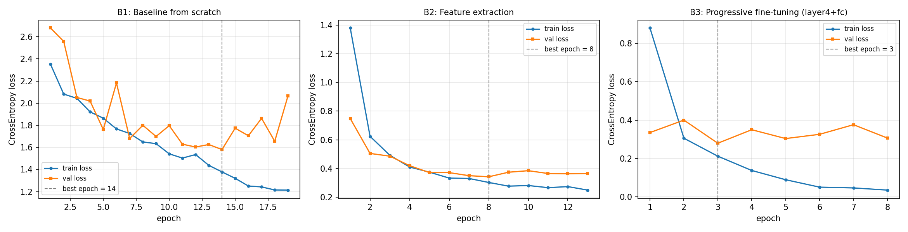
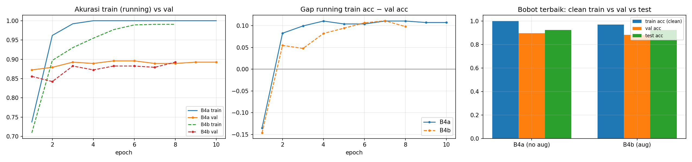
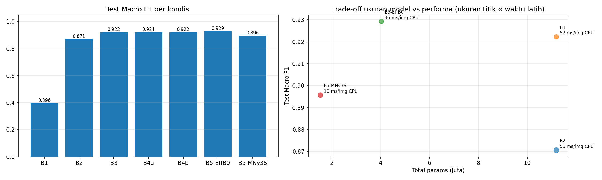
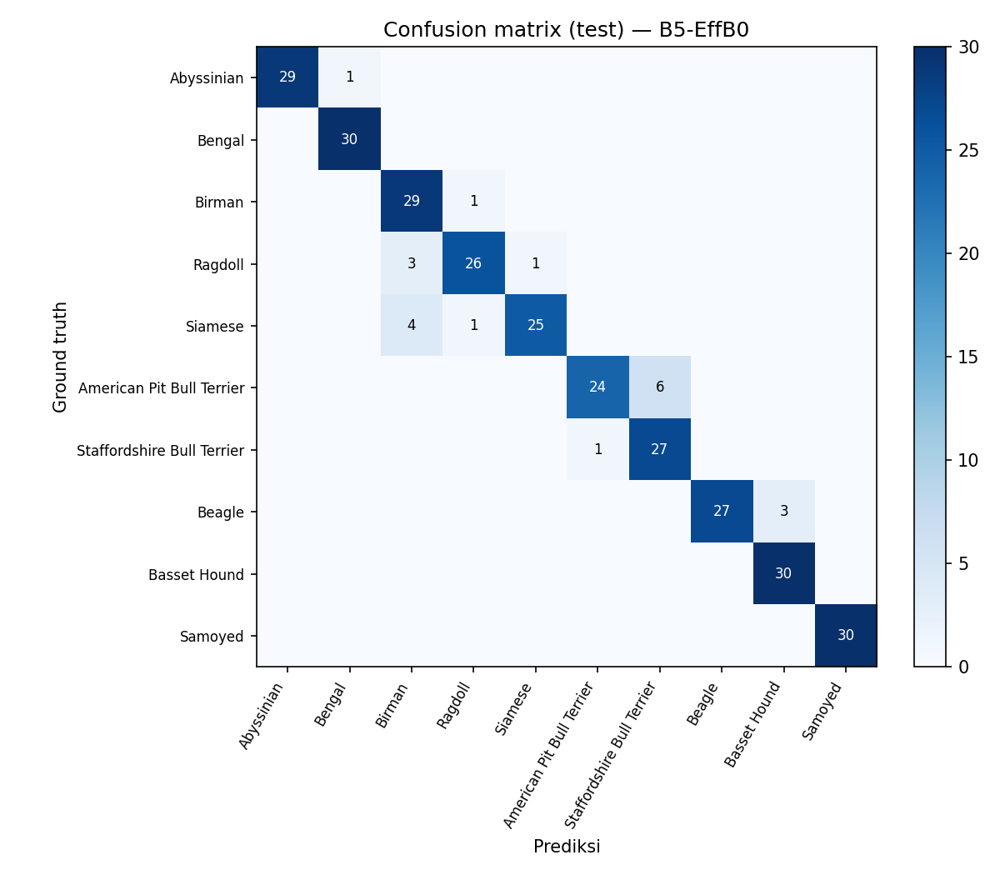
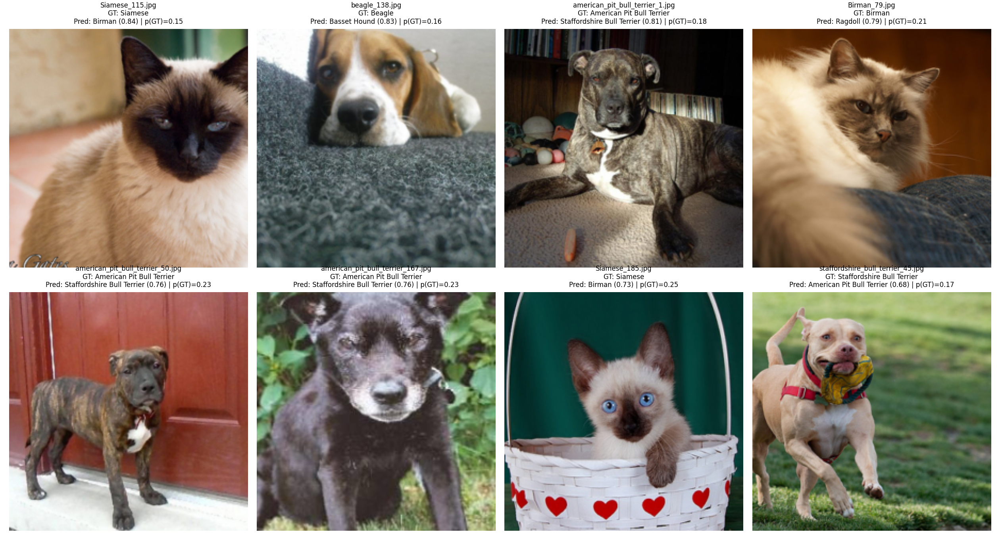
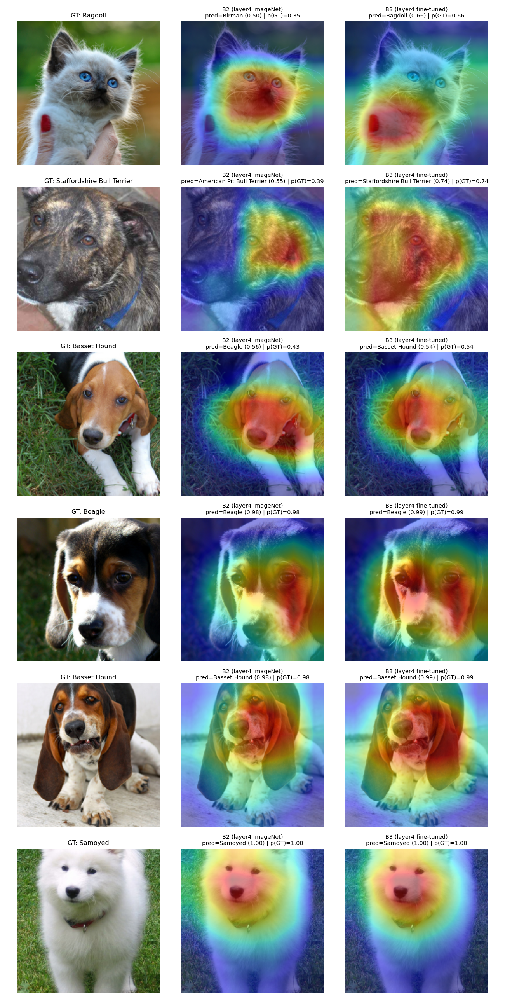
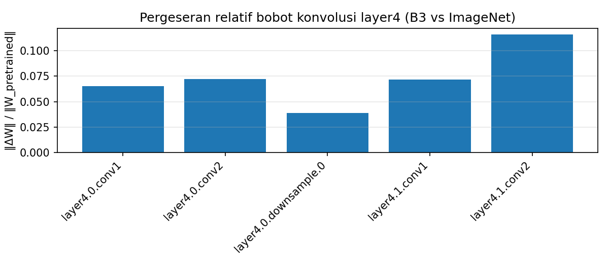

Nama: Adhitya Kusuma Ridwan
NIM: 2802391901

## Bagian A — Analisis Konseptual

### A1. Efek regularisasi Batch Normalization (Slide 6–8)

Saat training, BN menormalisasi setiap aktivasi menggunakan mean dan varians dari mini-batch yang sedang diproses, bukan dari seluruh dataset. Karena isi setiap mini-batch berbeda, estimasi tersebut selalu sedikit berfluktuasi. Oleh karena itu, citra yang sama menghasilkan aktivasi ternormalisasi yang berbeda di setiap iterasi. Fluktuasi ini berperan memasukkan noise yang mencegah jaringan bergantung pada nilai aktivasi yang terlalu spesifik, sehingga fitur yang dipelajari lebih kuat dan tahan terhadap perubahan (Ioffe & Szegedy, 2015). Saat inference, noise tersebut menghilang karena BN memakai mean dan varians yang tetap. Akan tetapi, efek ini relatif lemah sehingga Dropout tetap diperlukan pada kondisi tertentu. Pertama, jika batch size besar, estimasi hampir akurat sehingga noise nyaris tidak ada. Kedua, pada data yang sedikit dengan model berparameter besar, noise dari BN tidak cukup untuk mencegah overfitting. Ketiga, pada feature extraction seperti B2, BN pada backbone memakai statistik yang tetap sehingga tidak ada efek regularisasi.

### A2. Degradasi jaringan dan formulasi residual (Slide 10–12)

Degradation problem adalah fenomena ketika plain network yang lebih dalam memiliki training error lebih tinggi dibandingkan jaringan dangkal, misalnya jaringan 56 lapis terhadap 20 lapis pada CIFAR-10 (He et al., 2016). Fenomena ini bukan overfitting karena pada overfitting training error rendah tetapi test error tinggi, sedangkan pada degradation training error juga ikut naik. Secara teori, jaringan lebih dalam seharusnya minimal memiliki performa yang sama karena lapisan tambahan bisa dibuat sebagai identity mapping. Akan tetapi, optimizer sulit membuat lapisan non-linear menghasilkan fungsi identitas secara tepat. Residual learning mengatasi masalah ini dengan menambahkan input blok langsung ke output lapisan, sehingga output menjadi F(x) + x. Dengan begitu, lapisan hanya perlu mempelajari residual F(x), yang cukup didorong mendekati nol jika tidak ada perubahan yang diperlukan. Selain itu, jalur identitas membantu gradien mengalir ke lapisan awal dan mengurangi risiko vanishing gradient (Sesi 02), sehingga jaringan yang lebih dalam menjadi lebih mudah dilatih.

### A3. Feature extraction vs. fine-tuning (Slide 14–16)

Feature extraction dan fine-tuning memiliki perbedaan pada beberapa aspek. Dari sisi parameter, feature extraction pada ResNet-18 hanya melatih lapisan fc dengan 5.130 parameter, sedangkan fine-tuning pada layer4 dan fc melatih sekitar 8,4 juta parameter. Oleh karena itu, feature extraction lebih cocok untuk data yang sedikit, sedangkan fine-tuning memerlukan data lebih banyak agar tidak overfitting. Dari sisi komputasi, feature extraction lebih cepat dan hemat memori karena tidak melakukan backward pass ke backbone dan tidak menyimpan state optimizer untuk bobot yang tidak dilatih. Dari sisi risiko, feature extraction tidak mengubah bobot pretrained, sedangkan fine-tuning dapat merusak fitur yang sudah dipelajari jika learning rate terlalu besar. Secara praktis, feature extraction cocok digunakan ketika data sedikit dan domain mirip dengan ImageNet, sedangkan fine-tuning lebih cocok ketika data lebih banyak atau domain berbeda karena fitur pada lapisan akhir lebih spesifik terhadap tugas asal.

### A4. Kaidah data augmentation (Slide 20, 21, 23)

Data augmentation hanya diterapkan pada data latih karena tujuannya untuk memperbanyak variasi data agar model lebih tahan terhadap perubahan posisi, skala, atau pencahayaan. Sebaliknya, data validasi dan uji harus tetap merepresentasikan kondisi data nyata saat model digunakan. Jika data tersebut ikut diaugmentasi, hasil evaluasi tidak lagi menunjukkan performa model yang sebenarnya. Selain itu, evaluasi harus deterministik agar citra yang sama selalu menghasilkan skor yang sama, sehingga proses early stopping, pemilihan model, dan perbandingan antar eksperimen tetap adil. Untuk klasifikasi ras hewan, transformasi yang tidak cocok adalah hue shift yang terlalu kuat atau konversi grayscale karena warna bulu dapat menjadi ciri pembeda utama antar ras. Contohnya, pola color-point gelap pada Siamese, bulu kemerahan pada Abyssinian, dan bulu putih pada Samoyed. Perubahan warna dapat menghilangkan ciri tersebut atau membuat citra terlihat seperti ras lain, sehingga label tidak lagi sesuai dengan karakteristik gambar setelah transformasi.

### A5. Mitigasi catastrophic forgetting (Slide 28–29)

Catastrophic forgetting adalah kondisi ketika fine-tuning merusak fitur umum yang sudah dipelajari model dari ImageNet. Pada awal training, head baru masih memiliki bobot acak sehingga loss dan gradien bisa besar. Jika lapisan pretrained langsung dibuka dengan learning rate besar, gradien tersebut dapat mengubah bobot backbone terlalu jauh, terutama ketika data latih sedikit. Strategi pertama adalah differential learning rate, yaitu menggunakan learning rate kecil untuk lapisan pretrained, misalnya 1e-4 pada layer4, dan lebih besar untuk head, misalnya 1e-3. Hal ini karena bobot pretrained sudah memiliki fitur yang baik sehingga hanya perlu sedikit penyesuaian, sedangkan head perlu belajar dari awal. Strategi kedua adalah gradual unfreezing, yaitu melatih head terlebih dahulu dengan backbone beku, kemudian membuka lapisan pretrained secara bertahap. Dengan cara ini, backbone menerima gradien setelah head mulai belajar sehingga risiko merusak fitur pretrained berkurang.

## Bagian C — Laporan Eksperimen

### C1. Tabel konsolidasi dan kurva pembelajaran

Eksperimen menggunakan 1.986 citra dari 10 ras Oxford-IIIT Pet (5 kucing, 5 anjing) yang dibagi secara stratified menjadi 1.390 data latih, 298 data validasi, dan 298 data uji. Seluruh kondisi memakai protokol yang sama: input 224×224 dengan normalisasi ImageNet, optimizer AdamW (weight decay 1e-2), batch size 32, CrossEntropyLoss, early stopping pada validation loss dengan patience 5, dan seed 42, dijalankan pada GPU Tesla T4. Tabel 1 merangkum hasil seluruh kondisi berdasarkan berkas summary.csv.

| **Kode** | **Strategi**          | **Trainable params** | **LR**      | **Epoch konv. / total** | **Waktu latih (s)** | **Val acc** | **Val F1** | **Test acc** | **Test F1** | **Gap train−val** |
|----------|-----------------------|----------------------|-------------|-------------------------|---------------------|-------------|------------|--------------|-------------|-------------------|
| B1       | From scratch          | 11.181.642           | 1e-3        | 14 / 19                 | 156,5               | 0,433       | 0,418      | 0,416        | 0,396       | 0,023             |
| B2       | Feature extraction    | 5.130                | 1e-3 (fc)   | 8 / 13                  | 92,2                | 0,873       | 0,871      | 0,873        | 0,871       | 0,052             |
| B3       | Fine-tuning layer4+fc | 8.398.858            | 1e-4 / 1e-3 | 3 / 8                   | 55,1                | 0,883       | 0,882      | 0,923        | 0,922       | 0,087             |
| B4a      | B3 tanpa augmentasi   | 8.398.858            | 1e-4 / 1e-3 | 5 / 10                  | 31,9                | 0,896       | 0,895      | 0,923        | 0,921       | 0,104             |
| B4b      | B3 dengan augmentasi  | 8.398.858            | 1e-4 / 1e-3 | 3 / 8                   | 55,2                | 0,883       | 0,882      | 0,923        | 0,922       | 0,087             |
| B5       | EfficientNet-B0       | 3.168.550            | 1e-4 / 1e-3 | 3 / 8                   | 59,4                | 0,930       | 0,929      | 0,930        | 0,929       | 0,040             |
| B5       | MobileNetV3-Small     | 1.337.586            | 1e-4 / 1e-3 | 5 / 10                  | 71,3                | 0,859       | 0,857      | 0,896        | 0,896       | 0,096             |

*Tabel 1. Ringkasan metrik seluruh kondisi. F1 = Macro F1. Gap = akurasi train (dievaluasi tanpa augmentasi) − akurasi validasi pada bobot terbaik.*

*Gambar 1. Kurva train dan validation loss untuk B1, B2, dan B3. Garis putus-putus menandai epoch terbaik.*

### C2. Pembahasan analisis komparatif

#### C2.1 Disparitas B1 dan B2/B3

Transfer learning memberikan peningkatan yang sangat besar: Macro F1 uji naik dari 0,396 pada B1 menjadi 0,871 pada B2 dan 0,922 pada B3. Gap train−val B1 hanya 0,023, sehingga masalah utamanya bukan overfitting melainkan underfitting: model tidak mampu mempelajari representasi visual yang baik dari nol. Dengan hanya sekitar 139 citra per kelas, 11,2 juta parameter yang diinisialisasi acak tidak memperoleh sinyal yang cukup untuk membentuk fitur tepi, tekstur, dan bentuk secara bertahap. Kurva B1 menunjukkan train loss yang terus turun hingga epoch terakhir, sementara validation loss berfluktuasi tajam (1,58–2,18), sehingga early stopping menghentikan pelatihan pada epoch 19. Sebaliknya, B2 dan B3 mewarisi fitur yang telah dipelajari dari 1,2 juta citra ImageNet, sehingga sudah mencapai akurasi validasi di atas 0,75 sejak epoch pertama. Hal ini sejalan dengan prinsip bahwa jaringan dalam seperti ResNet membutuhkan data dalam jumlah besar untuk dilatih dari nol (Slide 10–12), sedangkan transfer learning memindahkan pengetahuan tersebut ke domain dengan data terbatas (Slide 16).

#### C2.2 Trade-off feature extraction dan fine-tuning

B3 unggul sekitar 5 poin Macro F1 dibandingkan B2 (0,922 vs. 0,871) dan konvergen lebih cepat (epoch terbaik 3 vs. 8). Membuka layer4 memungkinkan fitur tingkat tinggi beradaptasi dengan perbedaan halus antar ras. Namun, B3 melatih 8,4 juta parameter (75% dari total) dibandingkan hanya 5.130 parameter pada B2, sehingga memerlukan memori GPU lebih besar (384 MB vs. 288 MB). Kurva B3 memperlihatkan overfitting yang cepat: train loss terus turun hingga 0,03, sedangkan validation loss mencapai titik terendah pada epoch 3 lalu naik turun di sekitar 0,30–0,38, dan gap train−val lebih besar (0,087 vs. 0,052). Sebaliknya, kurva B2 paling stabil karena train dan validation loss hampir berimpit hingga epoch 5. Menariknya, waktu per epoch B2 dan B3 hampir sama (7,1 s vs. 6,9 s) meskipun B2 tidak melakukan backward pass ke backbone. Hal ini menunjukkan bahwa bottleneck pelatihan berada pada pemuatan dan augmentasi data di CPU, bukan pada komputasi GPU; total waktu B3 bahkan lebih singkat karena konvergen lebih cepat. Dengan learning rate 1e-4 untuk layer4, fine-tuning tetap stabil tanpa tanda kerusakan fitur pretrained (Slide 28).

#### C2.3 Peran data augmentation (B4)

*Gambar 2. Akurasi train dan validasi serta generalization gap untuk B4a (tanpa augmentasi) dan B4b (dengan augmentasi).*

Tanpa augmentasi (B4a), akurasi train mencapai 100% pada epoch 4 dan gap train−val sebesar 0,104, lebih besar daripada B4b (0,087). Augmentasi memperlambat proses menghafal data latih (B4b baru mencapai 99% pada epoch 6), sesuai fungsinya sebagai regularisasi (Slide 20). Namun, efek ini tidak berdampak pada performa uji: Macro F1 B4a dan B4b praktis sama (0,921 vs. 0,922), dan akurasi validasi B4a justru sedikit lebih tinggi. Pada akhir pelatihan, gap running kedua kondisi juga kembali setara (sekitar 0,10). Salah satu penyebab yang mungkin terlihat pada contoh augmentasi: rotasi menghasilkan sudut hitam dan kombinasi brightness/contrast kadang membuat citra terlalu terang, sehingga model berlatih pada artefak yang tidak pernah muncul pada data uji. Selain itu, augmentasi menggandakan waktu per epoch (3,2 s vs. 6,9 s). Hasil B4b identik dengan B3 hingga nilai loss setiap epoch, yang menunjukkan bahwa pipeline eksperimen sepenuhnya reproducible.

#### C2.4 Arsitektur pembanding (B5)

| **Model**         | **Total params** | **Memori GPU puncak (MB)** | **Latensi GPU (ms/batch 32)** | **Latensi CPU (ms/citra)** | **Test F1** |
|-------------------|------------------|----------------------------|-------------------------------|----------------------------|-------------|
| ResNet-18 (B2)    | 11,18 juta       | 288,2                      | 32,8                          | 58,3                       | 0,871       |
| ResNet-18 (B3)    | 11,18 juta       | 384,0                      | 32,2                          | 56,9                       | 0,922       |
| EfficientNet-B0   | 4,02 juta        | 409,4                      | 39,8                          | 36,4                       | 0,929       |
| MobileNetV3-Small | 1,53 juta        | 151,3                      | 11,1                          | 9,7                        | 0,896       |

*Tabel 2. Perbandingan efisiensi arsitektur dengan strategi fine-tuning blok terakhir.*

*Gambar 3. Macro F1 uji per kondisi dan trade-off ukuran model terhadap performa.*

Strategi terbaik berdasarkan validasi (fine-tuning blok terakhir) diterapkan pada dua arsitektur efisien (Slide 24). EfficientNet-B0 mencapai Macro F1 tertinggi (0,929) dengan parameter 2,8 kali lebih sedikit daripada ResNet-18, gap terkecil (0,040), dan latensi CPU lebih rendah (36 ms vs. 57 ms per citra). Namun, latensi GPU-nya lebih tinggi (39,8 ms vs. 32,2 ms per batch) karena depthwise convolution kurang efisien diparalelkan di GPU dibandingkan konvolusi standar. MobileNetV3-Small adalah model paling ringan (1,5 juta parameter, 151 MB memori, 9,7 ms per citra di CPU) dengan penurunan Macro F1 sekitar 2,6 poin dibandingkan ResNet-18 B3.

### C3. Failure analysis

*Gambar 4. Confusion matrix model terbaik (EfficientNet-B0) pada data uji.*

Model terbaik (EfficientNet-B0) salah memprediksi 21 dari 298 citra uji. Seluruh kesalahan terjadi antar ras dalam spesies yang sama, tidak pernah tertukar antara kucing dan anjing, dan 20 dari 21 kesalahan terkonsentrasi pada tiga kelompok ras yang mirip: Birman/Ragdoll/Siamese (10 kesalahan), American Pit Bull Terrier/Staffordshire Bull Terrier (7), dan Beagle→Basset Hound (3). Kesalahan Pit Bull bersifat tidak simetris (6 diprediksi sebagai Staffordshire, hanya 1 sebaliknya), sehingga recall Pit Bull menjadi yang terendah (80%). Sebaliknya, Bengal, Basset Hound, dan Samoyed diklasifikasikan sempurna karena memiliki ciri visual yang sangat khas.

*Gambar 5. Delapan kesalahan prediksi dengan confidence tertinggi.*

| **Citra**                     | **Ground truth → Prediksi (conf.)** | **Hipotesis penyebab**                                                                                                                                           |
|-------------------------------|-------------------------------------|------------------------------------------------------------------------------------------------------------------------------------------------------------------|
| Siamese_115                   | Siamese → Birman (0,84)             | Bulu tampak panjang dan mengembang, mata setengah tertutup sehingga ciri mata biru lemah, dan kaki tidak terlihat; kemungkinan kucing campuran atau label noise. |
| beagle_138                    | Beagle → Basset Hound (0,83)        | Close-up wajah dalam posisi berbaring; kaki dan tubuh tidak terlihat sehingga ciri panjang kaki hilang dan hanya telinga turun yang tersisa.                     |
| american_pit_bull_terrier_1   | Pit Bull → Staffordshire (0,81)     | Bulu brindle dengan dada putih, pencahayaan dalam ruangan yang gelap dengan sorotan tajam, dan tidak ada acuan ukuran tubuh.                                     |
| Birman_79                     | Birman → Ragdoll (0,79)             | Bulu sangat mengembang dan kaki tersembunyi sehingga ciri utama Birman (kaki putih seperti sarung tangan) tidak terlihat; pencahayaan hangat dan redup.          |
| american_pit_bull_terrier_50  | Pit Bull → Staffordshire (0,76)     | Anak anjing brindle dengan bercak putih di dada; proporsi tubuh anak anjing yang lebih kekar menyerupai Staffordshire.                                           |
| american_pit_bull_terrier_167 | Pit Bull → Staffordshire (0,76)     | Anjing tua berbulu hitam dengan moncong beruban; kontras rendah menyembunyikan detail wajah dan kualitas foto rendah.                                            |
| Siamese_185                   | Siamese → Birman (0,73)             | Anak kucing yang pola color-point-nya belum berkembang penuh dan bulunya masih mengembang; latar keranjang yang ramai.                                           |
| staffordshire_bull_terrier_43 | Staffordshire → Pit Bull (0,68)     | Postur berlari dengan tubuh ramping dan kaki panjang yang lebih khas Pit Bull; sebagian wajah tertutup mainan.                                                   |

*Tabel 3. Analisis kesalahan prediksi model terbaik.*

Dari pola tersebut terdapat empat penyebab utama. Pertama, ciri pembeda kunci sering tidak terlihat dalam citra, seperti kaki putih pada Birman, panjang kaki pada Beagle dan Basset, serta ukuran tubuh pada Pit Bull dan Staffordshire. Kedua, model tampaknya mempelajari jalan pintas berbasis warna bulu: ketiga kesalahan Pit Bull yang ditampilkan adalah anjing brindle atau berbulu gelap, yang menjelaskan ketidaksimetrisan kesalahan tersebut. Ketiga, hewan muda belum menampilkan ciri ras dewasa. Keempat, kesalahan terjadi dengan confidence tinggi (0,68–0,84), sehingga model tidak hanya salah tetapi juga terlalu yakin, yang menunjukkan masalah kalibrasi.

### C4. Rekomendasi rekayasa dan batasan

Untuk dataset kecil (±1.400 citra) dengan domain yang mirip ImageNet, strategi yang direkomendasikan adalah fine-tuning blok terakhir dengan differential learning rate dan early stopping, karena memberikan performa tertinggi pada ResNet-18 sekaligus konvergen paling cepat. Feature extraction tetap layak ketika memori sangat terbatas atau data jauh lebih sedikit, karena paling stabil dengan selisih performa sekitar 5 poin. Untuk deployment, EfficientNet-B0 adalah pilihan terbaik bila inferensi dilakukan di CPU karena unggul dalam akurasi dan latensi, sedangkan ResNet-18 lebih cepat pada GPU. MobileNetV3-Small direkomendasikan untuk perangkat edge dengan batasan latensi dan memori yang ketat. Augmentasi sebaiknya tetap dipakai namun dengan rotasi yang lebih ringan atau padding berupa refleksi agar tidak menghasilkan artefak sudut hitam.

Batasan eksperimen ini perlu diperhatikan. Seluruh hasil berasal dari satu seed, sehingga selisih kecil di bawah 1 poin (misalnya B3 vs. B4a) belum dapat dianggap signifikan. Eksperimen hanya mencakup 10 kelas dari satu dataset tanpa tuning learning rate atau scheduler. B3 membuka layer4 dan head secara bersamaan tanpa tahap pelatihan head terlebih dahulu. Pengukuran latensi juga mengandung noise: B3 dan B4b adalah model identik tetapi latensi CPU-nya berbeda (56,9 ms vs. 72,5 ms), dan waktu latih dipengaruhi oleh bottleneck pemuatan data pada lingkungan Colab bersama.

### C5. Grad-CAM dan pergeseran representasi layer4

*Gambar 6. Grad-CAM layer4 sebelum (B2, bobot ImageNet) dan sesudah fine-tuning (B3).*

*Gambar 7. Pergeseran relatif bobot konvolusi layer4 setelah fine-tuning.*

Tiga baris pertama pada Gambar 6 adalah citra yang salah diprediksi B2 tetapi benar pada B3. Setelah fine-tuning, perhatian model meluas dari pusat wajah ke area kepala, dada, dan tekstur bulu, yang relevan untuk membedakan ras serupa. Namun, pada citra Ragdoll, aktivasi terkuat B3 berada di dekat tangan manusia dan kuku berwarna merah, yang mengindikasikan kemungkinan model ikut memanfaatkan petunjuk palsu (spurious cue) dari latar belakang. Pada citra yang mudah (Beagle, Basset Hound, Samoyed), peta perhatian hampir tidak berubah karena fitur ImageNet sudah cukup (confidence 0,98–1,00). Gambar 7 menunjukkan bahwa bobot layer4 hanya bergeser 4–12% dari bobot ImageNet, sehingga fine-tuning menyesuaikan representasi tanpa menimpanya (tidak terjadi catastrophic forgetting). Lapisan terdalam (layer4.1.conv2) bergeser paling besar (±11,5%), sesuai dengan prinsip bahwa lapisan akhir paling spesifik terhadap tugas (Slide 29).

AI Model used: GPT (Learning) & Sonnet (Coding)

Ruang Lingkup:
- Membantu mengubah docx jadi Md file
- Membantu membuat kode
- Menjelaskan konsep dan materi dari google search dan slide
- Mengecek hasil ejaan dan ketepatan tulisan

Cara Verifikasi:
- Menjalankan dan review hasil google colab
- Mencocokan angka
- Google search konsepnya